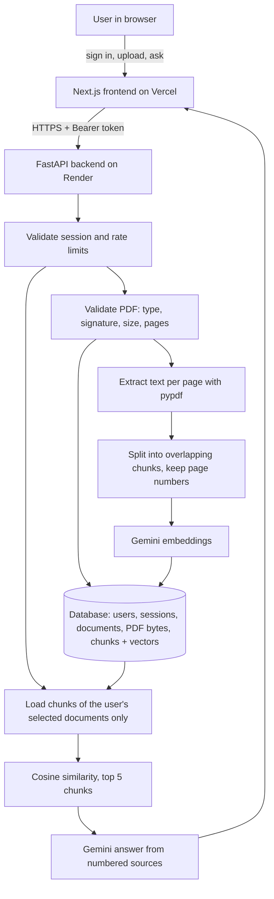

# DocuMind AI

**Author:** Rashmitha J

DocuMind AI is a private PDF question-answering app. You sign in, upload PDFs to your own document library, choose which documents to search, and ask questions. Answers come from Google Gemini, grounded in passages retrieved from your documents. Each answer lists its sources: the document name, page number and the exact supporting passage.

| Component | URL | Last verified (2026-10-20) |
|---|---|---|
| GitHub | https://github.com/rashmitha-j/DocuMind-AI | Repository reachable |
| Frontend (Vercel) | https://docu-mind-ai-delta.vercel.app/ | Page loads (HTTP 200) |
| Backend (Render) | https://documind-ai-backend-nzk0.onrender.com/ | `/health` returned 200 after a ~50 s cold start |
| Google AI Studio | https://aistudio.google.com/ | Not tested (account-specific) |

See [Project status](#project-status) for what has and has not been verified.

## Contents

- [Problem and objectives](#problem-and-objectives)
- [Features](#features)
- [Technology stack](#technology-stack)
- [Architecture](#architecture)
- [How documents are processed](#how-documents-are-processed)
- [Answers and citations](#answers-and-citations)
- [Authentication and privacy](#authentication-and-privacy)
- [Upload validation and rate limits](#upload-validation-and-rate-limits)
- [Database and storage](#database-and-storage)
- [Repository structure](#repository-structure)
- [Run locally](#run-locally)
- [Environment variables](#environment-variables)
- [Testing](#testing)
- [API reference](#api-reference)
- [Deployment](#deployment)
- [Free-tier notes](#free-tier-notes)
- [Troubleshooting](#troubleshooting)
- [Security guidance](#security-guidance)
- [Known limitations](#known-limitations)
- [Project status](#project-status)

## Problem and objectives

Long PDFs such as reports, contracts and course notes are slow to search by hand, and generic chatbots answer from general knowledge instead of from your document. DocuMind AI aims to:

- answer questions using only the content of the PDFs you select,
- show where every answer came from so you can check it,
- keep each user's documents private,
- run on free tiers (Vercel, Render, a free PostgreSQL provider and the Gemini free tier).

## Features

- **Accounts:** register, sign in and sign out. Sessions expire after 24 hours.
- **Document library:** upload up to 5 PDFs at a time, see each document's status, page count, size and upload date, open the original PDF, retry failed processing, and delete documents.
- **Multi-document questions:** select one or several ready documents. Retrieval searches only the selected documents.
- **Persistent indexes:** PDFs, chunks and embeddings are stored in the database, so they survive backend restarts. Uploading the same file again reuses the existing index instead of embedding it again.
- **Source citations:** each answer includes labelled sources (`[S1]`, `[S2]`, ...) with filename, 1-based page number, supporting excerpt and chunk ID.
- **Grounded prompting:** Gemini is told to answer only from the retrieved sources and to say when they do not contain enough information.
- **Validation and limits:** checks extension, MIME type, `%PDF-` signature, size, page count, encryption and extractable text. Rate limits cover sign-in, uploads, re-indexing and questions.
- **Clear errors:** Gemini quota, invalid-key, missing-model, timeout and network failures each return a specific message without leaking secrets.

## Technology stack

| Layer | Technology |
|---|---|
| Frontend | Next.js 16 (App Router), React 19, TypeScript, Tailwind CSS 4 |
| Backend | Python, FastAPI, Uvicorn |
| PDF parsing | `pypdf` |
| Chunking | LlamaIndex `SentenceSplitter` (`llama-index-core`) |
| Embeddings | Gemini `gemini-embedding-001` (768 dimensions) via `llama-index-embeddings-google-genai` |
| Answer model | Gemini `gemini-3.8-flash` via `llama-index-llms-google-genai` |
| Vector search | Cosine similarity with NumPy over the selected documents' stored vectors |
| Database | SQLAlchemy 2: SQLite locally, PostgreSQL (psycopg 3) in production |
| Passwords | Argon2id (`argon2-cffi`) |
| Tests | pytest with offline fake embeddings and a mock LLM |

## Architecture



The backend never calls Gemini at startup or from `/health`.

## How documents are processed

1. **Upload:** `POST /documents` receives up to 5 files. Each file is validated on its own, and a bad file does not block the others.
2. **Duplicate check:** the SHA-256 of the file is compared with the user's existing documents. If an identical file is already indexed, it is reused and nothing is embedded again.
3. **Store:** metadata and the original PDF bytes are committed first, with status `processing`.
4. **Extract:** `pypdf` extracts text page by page, and whitespace is normalised. Pages with no text are skipped. A PDF with no text at all is rejected with an "OCR needed" message.
5. **Chunk:** `SentenceSplitter` splits each page into chunks of 1024 tokens with 150 tokens of overlap. Every chunk keeps its 1-based page number.
6. **Embed:** chunk texts are embedded with Gemini and stored as normalised float32 vectors alongside the chunk text.
7. **Ready:** the status becomes `ready`. If embedding fails (quota, bad key, network), the status becomes `failed` with a readable error, and **Retry** (`POST /documents/{id}/reindex`) reprocesses the stored PDF.
8. **Interrupted work:** on startup, any document still marked `processing`, for example after a crash mid-upload, is marked `failed` so it can be retried.

Each document records the embedding model it was indexed with. If you change `GEMINI_EMBED_MODEL` or `GEMINI_EMBED_DIMENSIONS`, questions about older documents return a "retry processing" message instead of comparing incompatible vectors.

## Answers and citations

For `POST /chat` the backend:

1. checks the session and that **every** selected document belongs to the caller (otherwise `404`),
2. loads chunks filtered by both the document IDs and the caller's user ID,
3. embeds the question and ranks chunks by cosine similarity,
4. sends Gemini the top chunks as numbered sources, each labelled with filename and page,
5. returns the answer plus the sources it was given:

```json
{
  "answer": "The warranty lasts five years [S1].",
  "sources": [
    {
      "label": "S1",
      "chunk_id": 42,
      "document_id": "3f2c...",
      "filename": "contract.pdf",
      "page": 2,
      "score": 0.91,
      "excerpt": "The contract warranty lasts five years..."
    }
  ]
}
```

The `sources` list holds the chunks that were actually retrieved and given to the model. Whether the model cites them correctly in its text is not verified sentence by sentence. The frontend shows sources in a collapsible list under each answer. **Open** in the library shows the original PDF; there is no jump-to-page viewer.

## Authentication and privacy

- Passwords are hashed with Argon2id and never stored in plain text.
- Signing in returns a random bearer token. The database stores only its SHA-256 hash, together with an expiry time (`SESSION_TTL_HOURS`, default 24). Signing out deletes the session server-side.
- The frontend keeps the token in `sessionStorage` (cleared when the tab closes) and sends it in the `Authorization` header. Bearer tokens were chosen over cookies because the frontend (`vercel.app`) and backend (`onrender.com`) are different sites, where third-party cookies are blocked by Safari and increasingly by other browsers. The trade-off is that a cross-site scripting bug could read the token. The app renders all user content as plain text, not HTML.
- Every document, file, chunk, re-index, delete and chat query is filtered by the authenticated user's ID on the backend. Another user's document ID returns the same `404` as a missing one. Tests cover listing, metadata, download, re-index, delete, chat and mixed-ownership requests.
- Sign-in failures return the same message for unknown emails and wrong passwords. Registration does reveal whether an email is already registered.
- Set `ALLOW_REGISTRATION=false` to close sign-ups.

## Upload validation and rate limits

| Check | Default | Setting |
|---|---|---|
| File extension `.pdf` and MIME type `application/pdf` | required | — |
| File starts with `%PDF-` and parses with `pypdf` | required | — |
| Max file size | 10 MB | `MAX_FILE_SIZE_MB` |
| Files per upload | 5 | `MAX_FILES_PER_UPLOAD` |
| Request body limit (`Content-Length`) | files × size + 1 MB | derived |
| Max pages | 300 | `MAX_PDF_PAGES` |
| Documents per user | 50 | `MAX_DOCUMENTS_PER_USER` |
| Password-protected PDFs | rejected | — |
| Filenames | used for display only; storage uses generated IDs | — |

Rate limits return `429` with a `Retry-After` header:

| Action | Default (requests/seconds) | Key | Setting |
|---|---|---|---|
| Register / sign in | 10/60 | client IP, plus email for sign-in | `RATE_LIMIT_AUTH` |
| Upload | 10/3600 | user | `RATE_LIMIT_UPLOAD` |
| Retry processing | 10/3600 | user | `RATE_LIMIT_REINDEX` |
| Questions | 20/600 | user | `RATE_LIMIT_CHAT` |

The limiter keeps counters in process memory. That is correct for a single backend instance, which is what Render's free tier runs. With several instances or workers, each would count separately, and a shared store such as Redis would be needed.

## Database and storage

Tables are created automatically on startup (`Base.metadata.create_all`). There are no migration scripts yet. The schema lives in [`backend/database.py`](backend/database.py):

| Table | Purpose |
|---|---|
| `users` | email and Argon2 password hash |
| `auth_sessions` | SHA-256 token hash, user, expiry |
| `documents` | owner, filename, size, SHA-256, pages, status, error, embedding model, chunk count, timestamps |
| `document_files` | original PDF bytes, kept separate so listings never load them |
| `chunks` | document, owner, page, chunk index, text, float32 embedding |

Deleting a document removes its metadata, PDF bytes and chunks in one database transaction, so no orphaned vectors remain.

- **Local:** with no `DATABASE_URL`, SQLite is used at `backend/data/documind.db` (git-ignored).
- **Production:** set `DATABASE_URL` to a free hosted PostgreSQL database, for example Neon or Supabase. PDFs are stored in the database, so no separate object storage service is needed. A 10 MB PDF takes 10 MB of database space, plus about 3 KB per chunk for vectors. Check your provider's free storage limit.
- **Without `DATABASE_URL` on Render**, the backend falls back to SQLite on the container's temporary disk. Accounts and documents are then **lost** on every restart, redeploy or free-tier spin-down. `/health` reports `"durable_storage": false` in that case.

## Repository structure

```
DocuMind-AI/
├── backend/
│   ├── main.py            # FastAPI app, routes, upload pipeline, validation
│   ├── database.py        # SQLAlchemy models and engine setup
│   ├── security.py        # password hashing, sessions, rate limiter
│   ├── genai_service.py   # chunking, Gemini embeddings/answers, retrieval, error mapping
│   └── tests/             # offline pytest suite (no Gemini calls)
├── frontend/
│   ├── app/page.tsx       # sign-in screen, document library, chat UI
│   ├── app/layout.tsx
│   ├── lib/api.ts         # API client, types, timeouts and error handling
│   └── .env.example
├── requirements.txt       # backend runtime dependencies
├── requirements-dev.txt   # + test dependencies
├── .env.example           # backend environment template
└── README.md
```

## Run locally

Prerequisites: Python 3.11+, Node.js 20+, and a free Gemini API key from [Google AI Studio](https://aistudio.google.com/) (only needed for real uploads and questions; tests do not need it).

### Backend

```bash
python -m venv .venv
```

```bash
.venv/Scripts/activate
```

(On macOS/Linux: `source .venv/bin/activate`.)

```bash
pip install -r requirements-dev.txt
```

```bash
cp .env.example .env
```

Edit `.env` and set `GOOGLE_API_KEY`. Then start the API on http://127.0.0.1:8000 (interactive docs at `/docs`):

```bash
uvicorn main:app --app-dir backend --reload --port 8000
```

### Frontend

```bash
cd frontend
```

```bash
cp .env.example .env.local
```

```bash
npm install
```

```bash
npm run dev
```

Open http://localhost:3000, create an account, and upload a PDF.

## Environment variables

Backend (`.env` locally, Render Environment in production). See [`.env.example`](.env.example) for the full list.

| Variable | Required | Purpose |
|---|---|---|
| `GOOGLE_API_KEY` | yes | Gemini API key (server-side only) |
| `DATABASE_URL` | production | PostgreSQL URL; empty means local SQLite |
| `GEMINI_MODEL` | no | Answer model, default `gemini-3.8-flash` |
| `GEMINI_EMBED_MODEL` / `GEMINI_EMBED_DIMENSIONS` | no | Embedding model, default `gemini-embedding-001` / `768` |
| `ALLOWED_ORIGINS` | no | Extra CORS origins (comma-separated) |
| `ALLOW_REGISTRATION` | no | `false` disables sign-up |
| `SESSION_TTL_HOURS` | no | Session lifetime, default 24 |
| `RATE_LIMIT_*`, `MAX_*` | no | Limits listed above |

Frontend (`frontend/.env.local`, Vercel Environment Variables):

| Variable | Purpose |
|---|---|
| `NEXT_PUBLIC_API_URL` | Backend base URL, no trailing slash. Public; never put secrets in `NEXT_PUBLIC_*` variables. |

## Testing

All backend tests run offline. A deterministic keyword-count embedding and LlamaIndex's `MockLLM` replace Gemini, so tests use no API quota and need no key.

```bash
python -m pytest backend/tests
```

The suite covers PDF extraction, page-preserving chunking, upload validation (wrong type, fake PDF, corrupt, empty, too large, too many pages, scanned), multi-file upload, duplicate reuse without re-embedding, persistence across a simulated restart, recovery of interrupted processing, deletion cleanup, citation document/page accuracy, retrieval limited to selected documents, registration/login/logout/expiry, cross-user isolation on every document route, rate limits, CORS, and Gemini quota/key/timeout handling.

Frontend checks:

```bash
cd frontend
```

```bash
npx eslint
```

```bash
npm run build
```

## API reference

All routes except `/`, `/health`, `/auth/register` and `/auth/login` require `Authorization: Bearer <token>`.

| Method | Path | Description |
|---|---|---|
| GET | `/health` | Status, whether a Gemini key is configured, database type, durable storage flag |
| POST | `/auth/register` | `{email, password}` → `{token, expires_at, user}` |
| POST | `/auth/login` | `{email, password}` → `{token, expires_at, user}` |
| POST | `/auth/logout` | Ends the current session |
| GET | `/auth/me` | Current user |
| GET | `/documents` | The caller's documents |
| POST | `/documents` | Multipart upload, field `files` (repeatable) → per-file `results` |
| GET | `/documents/{id}` | Document metadata |
| GET | `/documents/{id}/file` | Original PDF |
| POST | `/documents/{id}/reindex` | Reprocess a failed document |
| DELETE | `/documents/{id}` | Delete document, file and chunks |
| POST | `/chat` | `{document_ids: [...], question}` → `{answer, sources}` |

Example:

```bash
TOKEN=$(curl -s -X POST http://127.0.0.1:8000/auth/login -H "Content-Type: application/json" -d '{"email":"you@example.com","password":"your-password"}' | python -c "import sys,json;print(json.load(sys.stdin)['token'])")
```

```bash
curl -X POST http://127.0.0.1:8000/documents -H "Authorization: Bearer $TOKEN" -F "files=@report.pdf;type=application/pdf"
```

```bash
curl -X POST http://127.0.0.1:8000/chat -H "Authorization: Bearer $TOKEN" -H "Content-Type: application/json" -d '{"document_ids":["<id>"],"question":"Summarise the key findings."}'
```

## Deployment

### Frontend: Vercel

1. Import the repository into Vercel with **Root Directory** `frontend`.
2. Set `NEXT_PUBLIC_API_URL=https://documind-ai-backend-nzk0.onrender.com`.
3. Pushes to the connected branch deploy automatically.

### Backend: Render

1. Web Service connected to this repository, root directory = repository root.
2. Build command: `pip install -r requirements.txt`
3. Start command: `uvicorn main:app --app-dir backend --host 0.0.0.0 --port $PORT`
4. Environment: `GOOGLE_API_KEY`, and **`DATABASE_URL`** pointing at a free PostgreSQL database (see [Database and storage](#database-and-storage)).
5. After deploy, check `/health`. It should show `"database": "postgresql"` and `"durable_storage": true`.

If the frontend URL changes, add it to `ALLOWED_ORIGINS` on Render.

## Free-tier notes

- **Render free:** the service sleeps after inactivity, and the first request can take about a minute (the frontend waits up to 120 s). The disk is temporary, so use an external database.
- **Gemini free tier:** request and token quotas apply, and models and limits can change. Quota errors are shown as a clear `429` message. The app never switches to a paid model.
- **Free PostgreSQL** (e.g. Neon, Supabase): storage and compute limits apply. Render's own free PostgreSQL expires after a limited period.
- **Vercel Hobby:** for personal, non-commercial use.

No paid service is required, but none of these free tiers is guaranteed to be unlimited or permanent.

## Troubleshooting

| Symptom | Likely cause / fix |
|---|---|
| "Could not reach the backend" on first load | Render is waking up; wait a minute and retry |
| Signed out after a while, or everything disappeared | Session expired (24 h), or the backend runs without `DATABASE_URL` and restarted |
| Upload shows "Indexing failed ... quota" | Gemini free-tier limit reached; wait, then press **Retry** |
| "API key is invalid" | Update `GOOGLE_API_KEY` on Render |
| "configured Gemini model is unavailable" | Set `GEMINI_MODEL` / `GEMINI_EMBED_MODEL` to a model your key can use |
| "No extractable text found" | Scanned PDF; run OCR first (not built in) |
| "indexed with a different embedding model" | Embedding settings changed; press **Retry** on that document |
| CORS error in the browser console | Add the frontend origin to `ALLOWED_ORIGINS` |
| 429 "Too many requests" | Rate limit hit; wait for the stated number of seconds |

## Security guidance

- Keep `GOOGLE_API_KEY` and `DATABASE_URL` only in server environment settings, never in Git or `NEXT_PUBLIC_*` variables. `.env` files are git-ignored. No real key was found in this repository's Git history when checked on 2026-10-20.
- Use HTTPS URLs in production (Vercel and Render provide them).
- Rotate the Gemini key in Google AI Studio if it is ever exposed.
- Consider `ALLOW_REGISTRATION=false` for a private deployment.
- The app is not audited for regulated or highly sensitive data.

## Known limitations

- No OCR for scanned PDFs.
- No chat history: conversations are kept only in the browser tab.
- No password reset or email verification.
- Rate limits are per process (fine for one Render instance, not for many).
- Processing is synchronous inside the upload request; very large PDFs can take a while. There is no background job queue.
- No database migration tool; schema changes need manual migration.
- Retrieval loads the selected documents' vectors into memory per question. That is fine for the per-user limits above, but not designed for very large libraries.
- Citations show page and passage; there is no in-app PDF viewer that jumps to the page.

## Project status

Verified on 2026-10-20:

- **Backend:** 46 offline pytest tests pass (no Gemini calls).
- **Frontend:** ESLint, TypeScript and `next build` pass.
- **Local end-to-end:** real frontend and backend, with fake AI models and SQLite. Covered: register, upload two PDFs, ask a question scoped to one document (correct document and page cited), restart the backend (session and library persisted), delete, sign out, and a 375 px mobile layout.
- **Live Gemini:** no live Gemini call was made while building this version, so real-model answer quality was not re-tested.
- **Production:** whether the new version is deployed, and whether `DATABASE_URL` is configured on Render, must be checked at `/health` after deployment.
